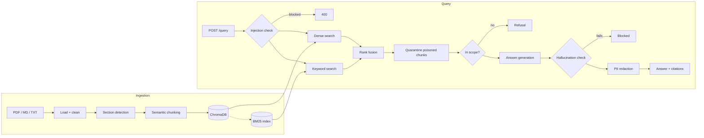

# Enterprise RAG & Guardrails Evaluation Engine

A retrieval-augmented question-answering service over enterprise documents (policies, financial reports), built around the parts that decide whether GenAI can ship in a real company: **document ingestion, hybrid search, guardrails, and automated evaluation.**

Ask a question → the system finds the relevant passages, answers only from them with citations, and refuses or blocks anything it shouldn't answer.

> **Runs entirely offline, no API key or cost.** By default, answers are assembled from the best-matching source sentences rather than written by an LLM, so every answer is traceable and test results are reproducible. An OpenAI integration (GPT generation, OpenAI embeddings, LLM-as-judge, Ragas metrics) is implemented behind a config switch but has **not** been run against the live API.

---

## Results

Offline benchmark on the bundled sample corpus (26 cases: 21 answerable, 3 out-of-scope, 2 prompt-injection attacks):

| Metric | Score |
|---|---|
| Faithfulness (answer claims supported by sources) | **1.00** |
| Context precision (relevant passages ranked first) | **0.97** |
| Context recall | **1.00** |
| Refusal accuracy (out-of-scope questions refused) | **1.00** |
| Injection block rate | **1.00** |
| Source hit rate (correct document retrieved) | **1.00** |
| Overall behavior accuracy | **26 / 26** |
| Median latency | **~8 ms** |

Plus **34 passing pytest tests** covering the API, retrieval, and every guardrail.

Faithfulness is 1.00 partly by design: in offline mode answers are drawn directly from source sentences. The hallucination guard is tested separately against deliberately fabricated answers (see `tests/test_rag.py`).

---

## What it does

### 1. Document ingestion (`app/ingestion.py`)
- Loads **PDF** (page by page), **Markdown** and **text** files.
- Cleans text (Unicode normalization, rejoins hyphenated line breaks).
- Detects section headings so chunks never mix two sections.
- **Semantic chunking**: splits where the topic shifts (adjacent-sentence similarity drops), within min/max size limits and with overlap.
- Every chunk keeps its **source file, page, section and a stable chunk ID**.
- Re-uploading an unchanged file is skipped; a changed file replaces its old chunks.

### 2. Hybrid retrieval (`app/rag_engine.py`)
- **Dense search** in ChromaDB plus **keyword search** with BM25, run together.
- Results merged with **weighted Reciprocal Rank Fusion**. Each citation shows whether it was found by dense search, keyword search, or both.
- A **grounded prompt template** (used in OpenAI mode) restricts the model to the retrieved passages, requires citations, and specifies an exact refusal sentence.

### 3. Guardrails (`app/guardrails.py`)

| Guardrail | What it stops |
|---|---|
| Input sanitization | Hidden characters used to sneak instructions past filters, oversized queries |
| Prompt-injection detection | "Ignore previous instructions", "reveal your system prompt", role-play jailbreaks, special tokens → **HTTP 400** |
| Poisoned-document quarantine | Instructions hidden *inside* ingested documents are dropped before answering |
| Out-of-scope gate | Questions the documents can't answer get a polite refusal instead of a guess |
| Year/number check | "Revenue in FY2019?" is refused when only FY2025 exists, instead of answering with the wrong year |
| Hallucination check | Every sentence in the answer must be supported by a source passage, and every number must appear in the sources; otherwise the answer is blocked |
| PII redaction | Emails, SSNs, phone and card numbers masked in output |

### 4. Evaluation (`evaluation/eval_benchmarks.py`)
- Runs every case in `benchmark_data.json` through the full pipeline.
- Measures **faithfulness, answer relevancy, context precision, context recall**, refusal accuracy, injection block rate and latency.
- Writes JSON + Markdown reports to `evaluation/results/`.
- `--gate` returns a failure exit code if any metric drops below its threshold, so it can block a bad change in CI.
- Optional backends (implemented, not yet run): **Ragas** LLM-judged metrics and **Arize Phoenix** tracing.

---

## Architecture



---

## Quick start

Requires Python 3.11+.

**Windows (PowerShell)**
```powershell
python -m venv venv
.\venv\Scripts\Activate.ps1
pip install -r requirements.txt
Copy-Item .env.example .env

python -m pytest                                  # run the 34 tests
python -m evaluation.eval_benchmarks --gate       # run the benchmark
uvicorn app.main:app --reload --port 8001         # start the API
```

**macOS / Linux**
```bash
make setup
make test
make evaluate
make run
```

Then open **http://localhost:8001/docs** (or `:8000` with `make run`) and use the interactive page:
1. `POST /ingest/directory` with `{"directory": "."}` to load the sample documents.
2. `POST /query` with `{"question": "What is the meal per diem?"}`.

---

## API

| Method | Endpoint | Purpose |
|---|---|---|
| `GET` | `/health` | Status and number of indexed chunks |
| `POST` | `/ingest` | Upload `.pdf` / `.txt` / `.md` files |
| `POST` | `/ingest/directory` | Load a folder from `data/` |
| `POST` | `/query` | Ask a question → answer, citations, guardrail report, timing |

Example response (shortened):
```json
{
  "answer": "The meal per diem is $85 per day for domestic travel and $110 per day for international travel. [1]",
  "refused": false,
  "citations": [
    {"index": 1, "source": "corvanta_travel_expense_policy.md", "section": "4. Meals and Per Diem",
     "dense_score": 0.35, "sparse_score": 7.5, "retrieved_by": "both", "cited": true}
  ],
  "guardrails": {
    "input":   {"passed": true, "injection_score": 0.0},
    "context": {"in_context": true, "query_coverage": 1.0},
    "output":  {"grounded_ratio": 1.0, "action": "pass"}
  }
}
```

Error codes: `400` injection or bad input · `415` unsupported file type · `422` unreadable file · `503` nothing loaded yet.

---

## Project structure

```
app/
  main.py          FastAPI endpoints
  ingestion.py     Loading, cleaning, semantic chunking
  rag_engine.py    Hybrid retrieval, rank fusion, answer generation
  guardrails.py    All guardrail layers
  config.py        Settings (override with RAG_* environment variables)
  providers.py     Offline vs. OpenAI model setup
evaluation/
  eval_benchmarks.py   Evaluation harness
  benchmark_data.json  26 test cases with ground truth
tests/test_rag.py      34 tests
data/                  Sample documents (fictional company)
```

---

## Tech stack

Python · FastAPI · Pydantic v2 · LangChain · ChromaDB · BM25 (rank-bm25) · pypdf · pytest · Ragas & Arize Phoenix (optional)

---

## Optional: OpenAI mode (not yet tested live)

The code supports GPT for answer writing and OpenAI embeddings for search. Set these in `.env`, delete the `.chroma` folder, and restart:
```
RAG_LLM_PROVIDER=openai
RAG_EMBEDDING_PROVIDER=openai
OPENAI_API_KEY=sk-...
```
LLM-judged evaluation: `pip install -r requirements-eval.txt`, then `python -m evaluation.eval_benchmarks --backend ragas`.

---

## Limitations

- In offline mode, answers are selected source sentences, not freely written text.
- Offline search relies on simple word-based embeddings; its out-of-scope threshold was tuned on this sample data and would need re-tuning for other documents.
- The injection detector is pattern-based; a production system would add a trained classifier.
- Scanned PDFs (images of text) need OCR first.

All company data in `data/` is fictional.